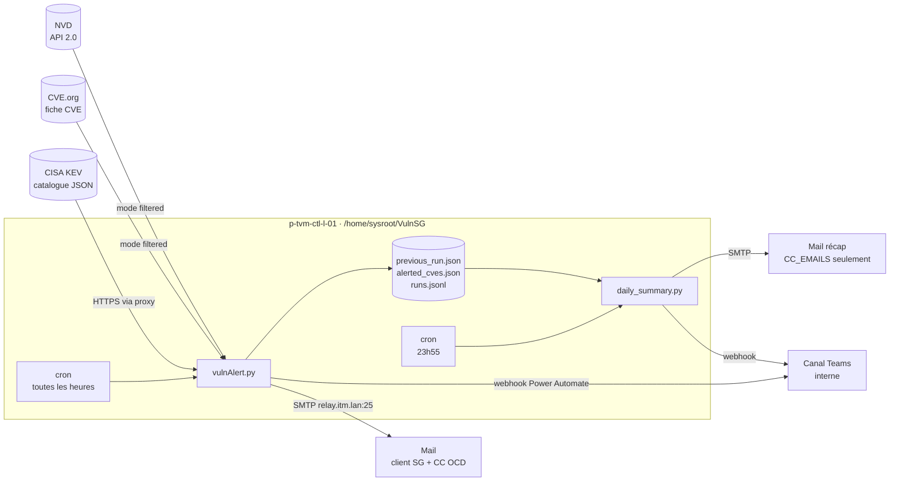
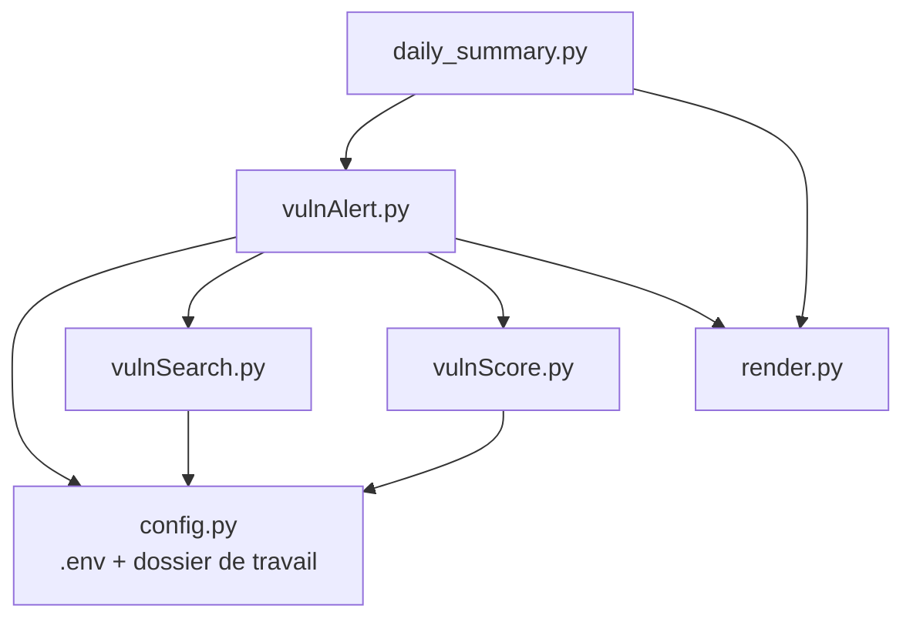
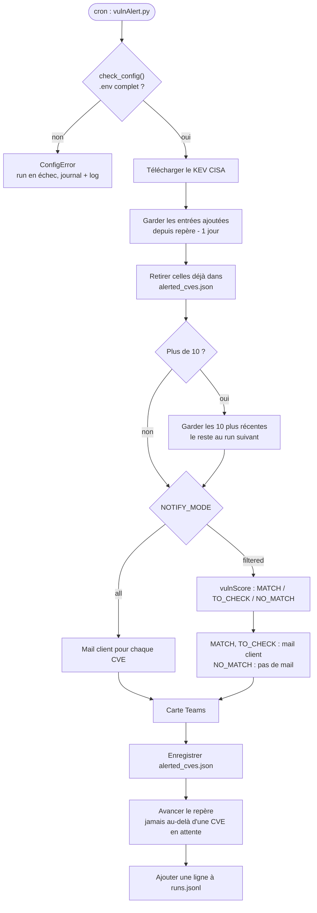
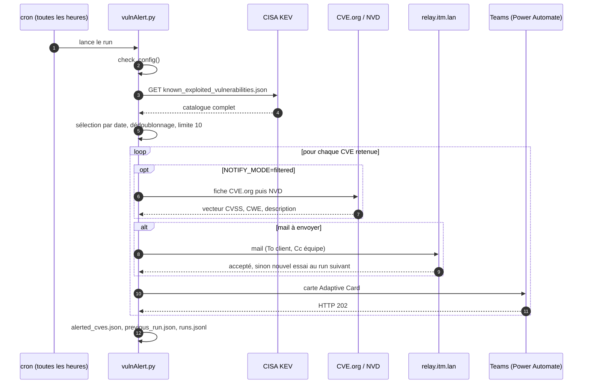
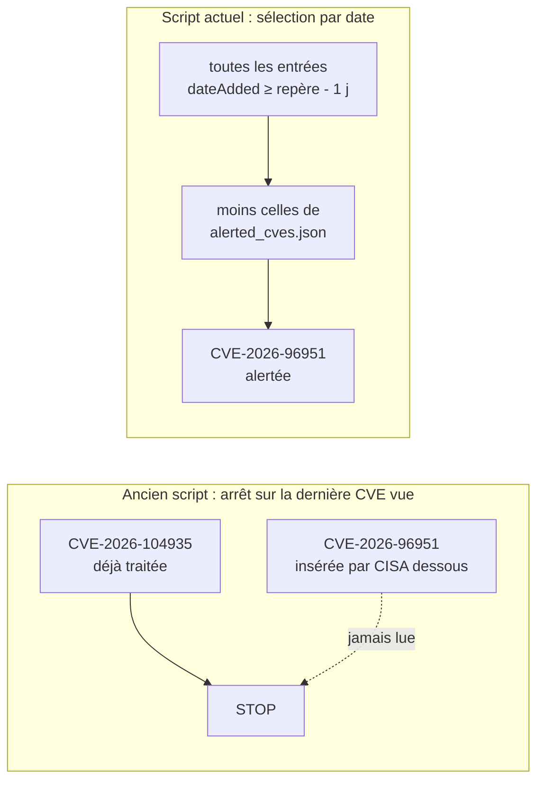
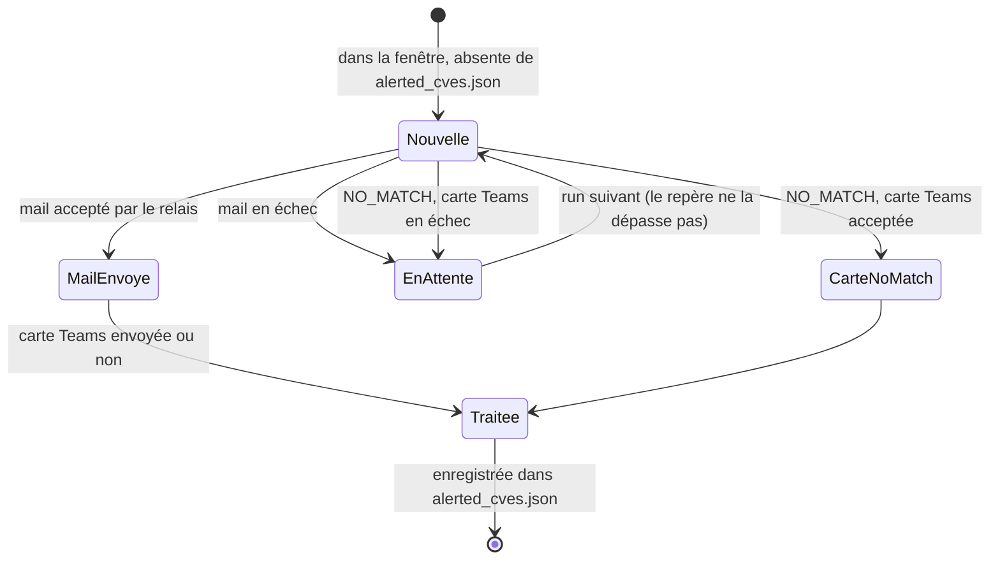
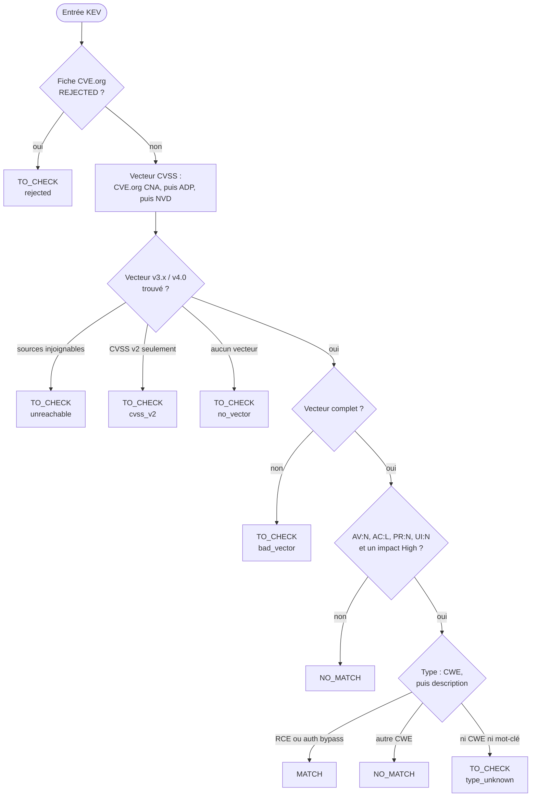
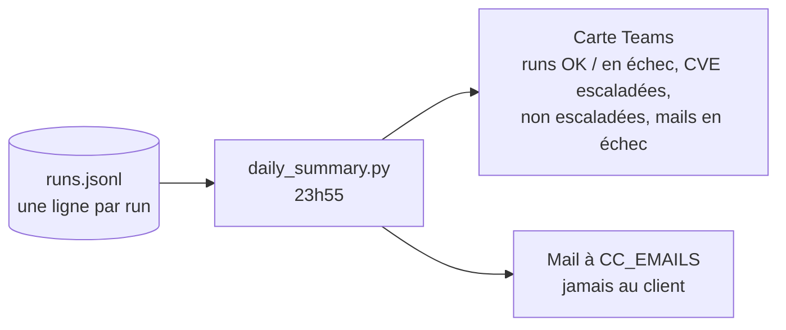
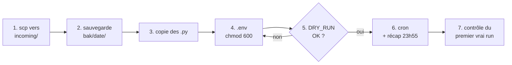

# VulnSearch

Surveillance du catalogue [CISA KEV](https://www.cisa.gov/known-exploited-vulnerabilities-catalog) (Known Exploited Vulnerabilities) pour Société Générale : chaque nouvelle CVE exploitée déclenche un mail et une carte Microsoft Teams.

Le script tourne toutes les heures en cron sur `p-tvm-ctl-l-01`, depuis `/home/sysroot/VulnSG/`. Un récap de la journée part chaque soir à 23h55.

- [Vue d'ensemble](#vue-densemble)
- [Fichiers](#fichiers)
- [Configuration](#configuration)
- [Fonctionnement d'un run](#fonctionnement-dun-run)
- [Sélection des entrées et repère](#sélection-des-entrées-et-repère)
- [Quand une CVE est-elle considérée comme traitée ?](#quand-une-cve-est-elle-considérée-comme-traitée-)
- [Mode `filtered` (critères SG)](#mode-filtered-critères-sg)
- [Récap du soir](#récap-du-soir)
- [Fichiers sur le serveur](#fichiers-sur-le-serveur)
- [Déploiement](#déploiement-sur-p-tvm-ctl-l-01)
- [Dépannage](#dépannage)
- [Commandes utiles](#commandes-utiles)

## Vue d'ensemble



Tout le trafic HTTPS sort par le proxy `http://172.18.9.100:8080`, déclaré dans la crontab.

## Fichiers

| Fichier | Rôle |
|---|---|
| `vulnAlert.py` | Point d'entrée du cron. Vérifie la configuration, envoie les mails et les cartes Teams, tient l'historique des alertes et le journal des runs. |
| `vulnSearch.py` | Récupère le KEV et sélectionne les entrées depuis le dernier passage, par date. |
| `vulnScore.py` | Critères SG : sous-scores CVSS et type RCE / contournement d'authentification, depuis CVE.org puis NVD. |
| `render.py` | Contenu des cartes Teams et des mails (HTML + texte). Aucun accès réseau. |
| `daily_summary.py` | Récap de la journée : une carte Teams et un mail aux seuls `CC_EMAILS`, jamais au client. Lit `runs.jsonl`. |
| `vulnExploit.py` | Enrichissement Metasploit / Exploit-DB. N'est pas appelé par le cron. |
| `config.py` | Charge le `.env` au démarrage et fixe le dossier de travail. |



## Configuration

La configuration se met dans un fichier `.env` à côté des scripts, jamais commité. Pars de `.env.example` :

```bash
cp .env.example .env && chmod 600 .env
```

`config.py` charge ce fichier au démarrage, sans dépendance. Une variable déjà définie dans l'environnement (crontab, shell) garde la priorité sur le `.env`. Aucune adresse ni aucun paramètre SMTP n'est écrit dans le code.

| Variable | Obligatoire | Effet |
|---|---|---|
| `TEAMS_WEBHOOK_URL` | en mode `filtered` | URL du webhook Power Automate. Vide : le script lit `.teams_webhook`. |
| `NOTIFY_MODE` | non (`all`) | `all` : un mail par nouvelle entrée KEV. `filtered` : critères SG (voir plus bas). |
| `SMTP_HOST` / `SMTP_PORT` | oui / non (`25`) | Relais SMTP. Production : `relay.itm.lan`, `25`. |
| `SMTP_HELLO` | oui | Nom annoncé au relais. Production : `p-tvm-ctl-l-01.prod-client.itm.lan`. |
| `SMTP_FROM` | oui | Expéditeur. Production : `monitoring_cybertools@cybersoc.orangecyberdefense.com`. |
| `SMTP_USER` / `SMTP_PASSWORD` | non | Si renseignés : STARTTLS + authentification. Inutile avec le relais interne. |
| `CUSTOMER_EMAILS` | oui | Destinataire (To) de toutes les alertes, séparés par des virgules. |
| `CC_EMAILS` | non | En copie (Cc) de toutes les alertes, et destinataires du récap du soir. |
| `NVD_API_KEY` | non | Clé NVD : 50 requêtes / 30 s au lieu de 5. |
| `DRY_RUN` | non | `1` : affiche ce qui serait envoyé, n'envoie rien et n'écrit aucun état. |
| `VULNSG_DIR` | non | Dossier des logs et des fichiers d'état. Défaut : `/home/sysroot/VulnSG` s'il existe, sinon le dossier des scripts. |
| `VULN_STATE_FILE` | non | Historique des CVE déjà traitées. Défaut : `$VULNSG_DIR/alerted_cves.json`. |
| `VULNSG_ENV_FILE` | non | Fichier de configuration à charger. Défaut : `.env` à côté des scripts. |

### Contrôle au démarrage

Avant même de lire le KEV, `vulnAlert.py` vérifie le `.env`. Sans ce contrôle, une ligne manquante ferait échouer chaque mail en silence, CVE par CVE, et SG ne recevrait rien.

| Problème | Résultat |
|---|---|
| `SMTP_HOST`, `SMTP_HELLO`, `SMTP_FROM` ou `CUSTOMER_EMAILS` vide | Run refusé |
| `SMTP_PORT` non numérique (vide = `25`) | Run refusé |
| `SMTP_USER` sans `SMTP_PASSWORD` | Run refusé |
| `NOTIFY_MODE` autre que `all` / `filtered` | Run refusé |
| Mode `filtered` sans webhook Teams | Run refusé (les `NO_MATCH` ne vont que sur Teams) |
| `MAIL_TEST_TO` ou `MAIL_EML_DIR` présent (anciens réglages de test) | Run refusé : avec eux, le client ne recevrait jamais les mails |
| Pas de webhook en mode `all` | Avertissement dans le log, mails seuls |

Un run refusé lève une `ConfigError` : le message apparaît dans le log du cron, le run est noté en échec dans `runs.jsonl`, et le récap du soir le signale dans « Failed runs ».

## Fonctionnement d'un run



Le même run, vu des systèmes externes :



## Sélection des entrées et repère

Le champ `dateAdded` du KEV est une date sans heure, calculée à l'heure de la côte Est des États-Unis. Le script garde donc un jour de chevauchement :

- **repère** : la date stockée dans `previous_run.json` (`date_added`) ;
- **fenêtre lue** : toutes les entrées dont `dateAdded` ≥ repère − 1 jour ;
- **dédoublonnage** : une CVE déjà présente dans `alerted_cves.json` n'est jamais renvoyée.

L'ordre des entrées dans le fichier CISA n'a aucune importance. C'est la correction de l'incident du 13/10/2026 :



### Ce que le script n'enverra jamais

- **Tout le catalogue** : sans `previous_run.json` (premier run, fichier supprimé), le script ne remonte qu'**un jour** en arrière.
- **Une CVE déjà alertée** : `alerted_cves.json` l'en empêche, quel que soit le repère.
- **Une vague d'alertes** : 10 au maximum par run, les suivantes partent aux runs suivants.

Au premier run après un déploiement, une CVE de la veille que l'ancien script aurait ratée part en rattrapage. `DRY_RUN=1 python3 vulnAlert.py` affiche exactement ce que le prochain run enverra.

## Quand une CVE est-elle considérée comme traitée ?



- Un mail parti n'est **jamais renvoyé**, même si la carte Teams qui suit échoue : on évite les doublons chez le client.
- Un mail en échec est **retenté** au run suivant. Le repère reste à sa date, pour qu'elle reste dans la fenêtre.
- Un `NO_MATCH` n'a pas de mail : sa carte Teams est sa seule trace. Il n'est enregistré qu'une fois la carte acceptée.

## Mode `filtered` (critères SG)

Étude de faisabilité, désactivée par défaut (`NOTIFY_MODE=all`). Pour chaque nouvelle entrée, `vulnScore.py` évalue :

| Critère | Valeur attendue |
|---|---|
| `AV` Attack vector | `N` (réseau) |
| `AC` Attack complexity | `L` (faible) |
| `PR` Privileges required | `N` (aucun) |
| `UI` User interaction | `N` (aucune) |
| Impact | au moins un de `C` / `I` / `A` à `H` (CVSS 4.0 : `VC` / `VI` / `VA`) |
| Type | RCE ou contournement d'authentification |



| Statut | Action |
|---|---|
| `MATCH` | Mail au client (`CUSTOMER_EMAILS`), équipe et L1 en CC (`CC_EMAILS`), carte Teams |
| `TO_CHECK` | Mail au client, équipe et L1 en CC, avec la raison et les étapes de vérification. Le client vérifie lui-même, le L1 appelle seulement. Carte Teams. |
| `NO_MATCH` | Pas de mail, carte Teams seulement |

En cas de doute (source injoignable, données manquantes, erreur), le résultat est toujours `TO_CHECK`, jamais un silence.

Type de vulnérabilité, déduit des CWE puis de la description. C'est une heuristique, à valider avec SG :

| Type | CWE | Mots-clés de secours dans la description |
|---|---|---|
| RCE | 77, 78, 94, 95, 98, 502, 917, 1336 | remote code execution, RCE, execute arbitrary code / commands, code injection, command injection |
| Contournement d'authentification | 287, 288, 290, 294, 302, 304, 305, 306, 1390 | authentication bypass, bypass authentication, missing authentication, unauthenticated access |

Sans clé NVD, le script attend 6,5 s entre deux appels NVD (limite de 5 requêtes / 30 s) : un run de 10 CVE en mode `filtered` prend environ une minute.

## Récap du soir

`daily_summary.py` lit les lignes de `runs.jsonl` du jour et garde, pour chaque CVE, son dernier résultat (un mail en échec à 10h et parti à 11h compte comme envoyé).



La carte est verte si tout va bien, rouge s'il y a un run en échec ou un mail en attente. Carte et mail sont indépendants : l'échec de l'un n'empêche pas l'autre.

## Fichiers sur le serveur

| Fichier | Contenu | Écrit par |
|---|---|---|
| `.env` | Configuration (chmod 600) | à la main |
| `.teams_webhook` | Webhook, si absent du `.env` (chmod 600) | à la main |
| `previous_run.json` | Repère : `date_added` et heure du dernier run | `vulnAlert.py`, après les envois |
| `alerted_cves.json` | Liste des CVE déjà traitées | `vulnAlert.py`, écriture atomique |
| `runs.jsonl` | Journal : une ligne JSON par run | `vulnAlert.py` (hors `DRY_RUN`) |
| `vulnscan.log` | Log détaillé de l'application | tous les scripts |
| `/home/sysroot/logs/vulnAlert_AAAAMMJJ.log` | Sortie du cron, un fichier par jour | crontab |

## Déploiement sur `p-tvm-ctl-l-01`

Fichiers à copier : `vulnAlert.py`, `vulnSearch.py`, `vulnScore.py`, `render.py`, `daily_summary.py`, `vulnExploit.py`, `config.py`, `requirements.txt`, `.env.example`.



1. Depuis le poste, copier les fichiers dans un dossier de dépôt sur le serveur :

   ```bash
   scp vulnAlert.py vulnSearch.py vulnScore.py render.py daily_summary.py vulnExploit.py \
       config.py requirements.txt .env.example <utilisateur>@p-tvm-ctl-l-01:/home/sysroot/VulnSG/incoming/
   ```

2. Sur le serveur, sauvegarder l'existant :

   ```bash
   cd /home/sysroot/VulnSG
   B=bak/$(date +%Y%m%d-%H%M) && mkdir -p "$B" && cp -p *.py previous_run.json alerted_cves.json "$B"/ 2>/dev/null
   cat previous_run.json        # date récente attendue
   ```

3. Installer les nouveaux fichiers :

   ```bash
   cp incoming/*.py incoming/requirements.txt incoming/.env.example .
   ```

4. Créer le `.env` (une seule fois) et le compléter : `CUSTOMER_EMAILS`, `CC_EMAILS`, et `TEAMS_WEBHOOK_URL` ou le fichier `.teams_webhook`.

   ```bash
   [ -f .env ] || cp .env.example .env
   chmod 600 .env && vi .env
   ```

5. Test à blanc : rien n'est envoyé, aucun état n'est écrit. La liste affichée est exactement ce que le prochain run enverra.

   ```bash
   export HTTPS_PROXY=http://172.18.9.100:8080
   DRY_RUN=1 python3 vulnAlert.py
   python3 daily_summary.py --dry
   ```

   Une `ConfigError` indique la ligne du `.env` à corriger. `New KEV entries: 0` est normal s'il n'y a rien de nouveau depuis le dernier passage.

6. Le cron horaire reste inchangé. Ajouter le récap du soir, après le dernier run de 23h00 :

   ```
   0 */1 * * * /usr/bin/python3 /home/sysroot/VulnSG/vulnAlert.py >> /home/sysroot/logs/vulnAlert_$(date +\%Y\%m\%d).log 2>&1
   55 23 * * * /usr/bin/python3 /home/sysroot/VulnSG/daily_summary.py >> /home/sysroot/logs/vulnAlert_$(date +\%Y\%m\%d).log 2>&1
   ```

7. Après le premier vrai run :

   ```bash
   tail -50 /home/sysroot/logs/vulnAlert_$(date +%Y%m%d).log
   tail -1 runs.jsonl                 # "ok": true attendu
   cat previous_run.json
   ```

**Retour arrière** : restaurer les scripts **et** le repère, garder l'historique actuel :

```bash
cp -p bak/<date>/*.py bak/<date>/previous_run.json .
```

Le `previous_run.json` restauré est indispensable. Le nouveau script n'y écrit plus `last_cve`, et l'ancien, sans `last_cve`, retraite tout le catalogue : il enverrait alors au client, par paquets de 10 chaque heure, toutes les CVE absentes de `alerted_cves.json`. `alerted_cves.json`, lui, reste en place : il contient aussi les CVE alertées par la nouvelle version, ce qui évite les doublons. L'ancienne version ignore `runs.jsonl` et `.env`.

## Dépannage

| Symptôme | Cause probable | Vérification |
|---|---|---|
| `ConfigError: configuration error in .env: ...` | Ligne manquante ou invalide dans le `.env` | Le message nomme la variable |
| Aucun mail, `Email failed for CVE-...` dans `vulnscan.log` | Relais SMTP injoignable ou refus | `grep "Email failed" vulnscan.log`, la CVE sera retentée |
| Carte Teams absente malgré `HTTP 202` | Power Automate accepte la requête puis échoue dans le flux | Historique d'exécution du flux dans Power Automate |
| `Teams alert failed` | Webhook expiré, régénéré ou mal copié | `TEAMS_WEBHOOK_URL` ou `.teams_webhook` |
| Erreur réseau sur `cisa.gov` | Proxy non exporté en shell interactif | `export HTTPS_PROXY=http://172.18.9.100:8080` |
| Run long en mode `filtered` | Limite NVD sans clé (6,5 s par appel) | Renseigner `NVD_API_KEY` |
| `entries postponed to next run` | Plus de 10 nouvelles CVE d'un coup | Normal, elles partent aux runs suivants |

## Commandes utiles

```bash
# Ce que le prochain run prendrait, sans rien envoyer
DRY_RUN=1 python3 vulnAlert.py
DRY_RUN=1 NOTIFY_MODE=filtered python3 vulnAlert.py

# Récap de la journée (carte Teams + mail aux CC_EMAILS uniquement)
python3 daily_summary.py --dry
python3 daily_summary.py --date 2026-10-19

# Dernier run, lisible
tail -1 runs.jsonl | python3 -m json.tool

# CVE déjà traitées
python3 -c "import json; print(len(json.load(open('alerted_cves.json'))), 'CVE')"
```
